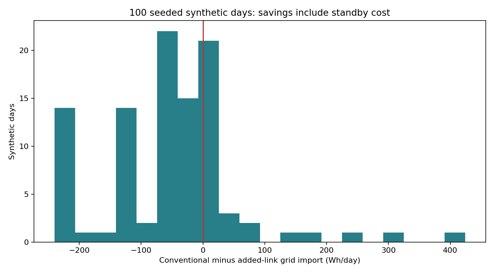
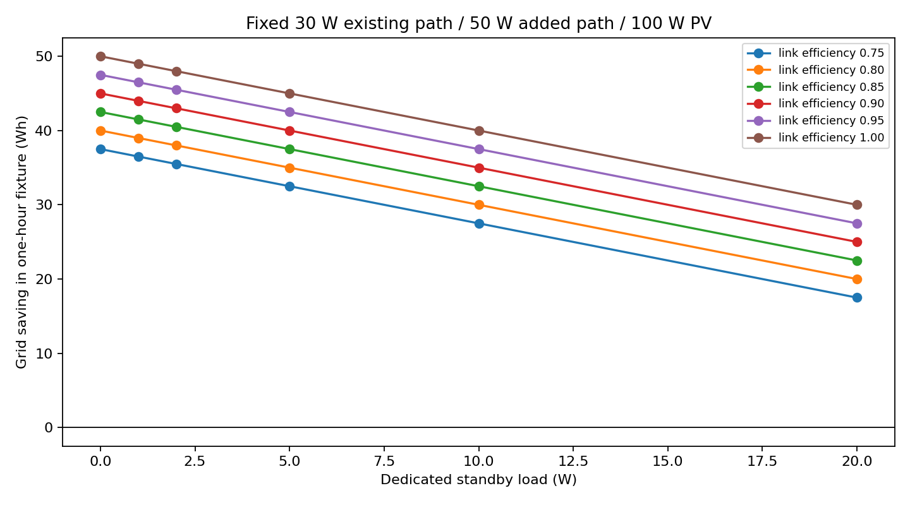

# HELIOROUTE expanded simulation study

Prototype Pioneers · Team 160289 · SIH26217 · 3 October 2026

The added routing link has a conditional benefit. Across 100 varied synthetic days, it reduced grid import in 21, increased it in 72 and tied in 7. Standby demand can dominate the recovered renewable energy. Loss-aware greedy and the restricted optimizer agreed throughout the study; the evidence supports no optimizer-superiority claim.

## Experiment design

The existing discrete-step, two-feeder energy model is retained. All traces and ratings are synthetic assumptions. `study.py` declares seed 2621703, generates every input, runs five policies against each common step, and saves complete input/parameter/dispatch records in `results/study_20261003/dispatch.jsonl.gz`.

| Group | Cases | Input steps | Purpose |
|---|---:|---:|---|
| Seeded days | 100 | 28,800 | 24 hours at 5-minute resolution; both feeder supply and demand varied |
| Factorial sensitivity | 216 | 216 | Six existing capacities × six added-link efficiencies × six standby demands |
| Capped-grid stress | 10,000 | 10,000 | Source/load/conversion/capacity variation, finite grid caps and fault flags |
| Total | 10,316 | 39,016 | 195,080 dispatch records across five policies |

Seeded days vary PV peak independently over 0–600 W per feeder, nominal load over 20–200 W, source/load efficiencies over 0.90–1.00, daylight over 8–14 hours, and cloud/load multipliers at each step. Existing path efficiency is 0.90–1.00; added-link efficiency is 0.75–1.00. Existing and added sending/receiving capacities vary independently. Standby is selected from 0, 1, 2, 5 or 10 W. Link availability and telemetry freshness each fail independently with 5% probability per step. Grid backup is unconstrained in this group, permitting full-service comparisons.

The factorial experiment holds raw PV at A=100 W, B=0 W and loads A=20 W, B=100 W for one hour. Source/load/existing-path efficiencies are unity. Existing sending ratings are 0, 10, 30, 50, 80 and 200 W; added sending rating is 50 W; added efficiencies are 0.75, 0.80, 0.85, 0.90, 0.95 and 1.00; standby loads are 0, 1, 2, 5, 10 and 20 W.

Capped-grid stress uses 0–1,000 W independent PV/load draws, 0.50–1.00 efficiencies, 0–500 W sending/receiving ratings, 0–20 W standby and grid caps drawn from zero, a finite 0–500 W value, or an effectively unconstrained bound. Each record represents one second. Those tiny Wh values must not be presented as daily results.

These distributions are deliberately broad engineering exploration. Counts describe the sampled fixtures; they are neither field probabilities nor deployment reliability estimates. There is no physical calibration or held-out empirical dataset.

## Computed results

| Group | Valid full-service pairs | Beneficial | Equal | Adverse | Service-invalid pairs |
|---|---:|---:|---:|---:|---:|
| Seeded days | 100 | 21 | 7 | 72 | 0 |
| Factorial | 216 | 144 | 12 | 60 | 0 |
| Capped-grid stress | 3,163 | 700 | 0 | 2,463 | 6,837 |

In the daily set, grid saving ranged from −240.00 to +424.14 Wh/day. Negative values are increased grid consumption at equal useful service. In the factorial set, the range was −20.00 to +50.00 Wh for the one-hour fixture. Savings are withheld whenever either policy fails useful service or the added controller's required standby cannot be supplied.





For the 30 W existing-path fixture, 50 W of added-path sending capacity has a recoverable benefit of 50η Wh before standby when full sending capacity is used. The plotted net gain is consequently 50η − Pstandby Wh. If the existing lossless path already carries the entire surplus, the additional link provides no useful benefit and standby remains a cost.

## Verification and reproduction

The original baseline contains 15 scenarios and 845 dispatch rows. The final Python suite contains 21 tests: the original 17 plus four independent study-audit mutation checks. Existing tests include 2,000 fixed-seed profiles across five policies and 45 independent mesh cross-checks. The expanded study adds 195,080 runtime accounting checks and a separate serialized-artifact audit that imports no dispatch code.

The saved study audit recomputed node/global closure, path loss and sending/receiving constraints, grid caps, disabled-link behavior, summary integrals and fairness gates. Maximum absolute global residual in the executed study was 6.8213 × 10⁻¹³ W, below the 10⁻⁷ W threshold. Numerical residual is not measurement accuracy.

```powershell
python -m venv .venv
.\.venv\Scripts\python.exe -m pip install -r requirements.lock
.\.venv\Scripts\python.exe -m helioroute.run
.\.venv\Scripts\python.exe study.py --out results/my-study
.\.venv\Scripts\python.exe verify_study.py results/my-study
```

The full study requires a fresh output directory. `--days 2 --trials 50` provides a reduced local/CI check while retaining the factorial grid. The compressed raw log uses a fixed gzip timestamp, and `cases.csv` is deterministic for fixed source, settings and seed. Runtime/platform and provenance timestamps can vary. SHA-256 files identify the saved artifacts; source hashes in the execution manifest preserve the source snapshot used at execution. Subsequent documentation and audit improvements are recorded separately rather than retroactively changing that snapshot.

## Engineering decision and next gate

Prioritize low standby power and sites with demonstrable source/demand mismatch and an existing transfer bottleneck. Establish the converter topology, losses versus operating point, controller supply and failure behavior with calibrated measurements before a hardware claim. A general service-allocation controller is still needed to address the known local-first counterexample under binding grid caps. No voltage/current, switching transient, stability, protection, MPPT, thermal or cost/payback conclusion follows from this model.
